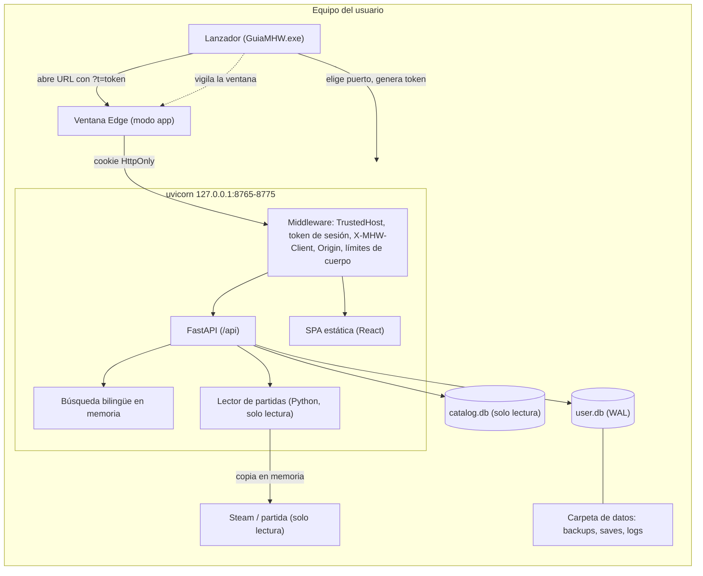
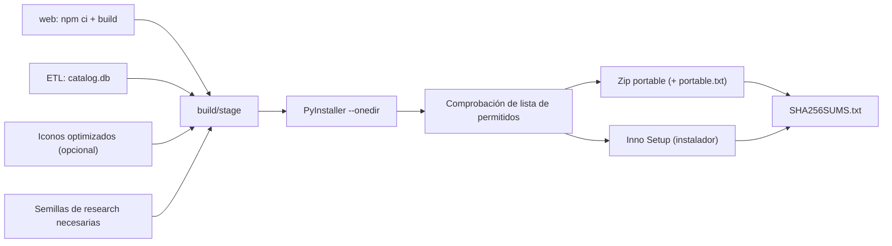

# Arquitectura

Guía MHW Iceborne · PC es una aplicación de escritorio para Windows que funciona sin conexión. Un lanzador arranca un servidor HTTP local, abre una ventana de Edge en modo aplicación y detiene el servidor cuando esa ventana se cierra.

## Componentes y flujo de datos

### Lanzador (`api/app/launcher.py`)

1. Resuelve la carpeta de datos: `GuiaMHW\data` junto al ejecutable si existe `portable.txt`; si no, `%LOCALAPPDATA%\GuiaMHW`. Usa un mutex por carpeta para permitir una sola instancia y enfocar la que ya corre.
2. Busca un puerto libre entre 8765 y 8775 y escucha solo en `127.0.0.1`.
3. Genera un token de sesión aleatorio para esa ejecución y arranca uvicorn.
4. Abre `msedge.exe` (ruta localizada en el registro de Windows, validada) con `--app=http://127.0.0.1:<puerto>/?t=<token>` y un perfil propio y privado. No usa banderas de depuración ni de desactivación de seguridad.
5. Vigila la ventana: si Edge cede la ventana a otro proceso, un vigilante de presencia de ventana (comprobación cada pocos segundos) detiene el servidor tras varios fallos seguidos. Si no hay Edge, usa el navegador por defecto con un temporizador de actividad más tolerante.

Nunca pide administrador, ni instala servicios, tareas, arranque automático ni reglas de firewall, ni escribe en el registro.

### Servidor (`api/app/main.py`, `static.py`)

- **FastAPI** sirve `/api/*` y, el último en montarse, la SPA compilada (`web/dist`) y los iconos. La ruta de archivos estáticos usa `safe_join` (resuelve enlaces simbólicos y rechaza `..`, `\`, NUL y codificaciones dobles) y añade cabeceras `X-Content-Type-Options`, `X-Frame-Options: DENY` y `frame-ancestors 'none'`.
- **Sesión:** el token llega una sola vez en la URL (`?t=`); el servidor lo cambia por una cookie `HttpOnly` con `SameSite=Strict` y redirige a `/` para quitarlo de la URL. Toda `/api` (salvo `GET /api/health`) exige esa cookie.
- En el ejecutable empaquetado no se exponen `/docs`, `/redoc` ni `openapi.json`.

### Datos

- **`catalog.db`** (SQLite): el catálogo generado por el ETL. Se adjunta como `mhw` en modo solo lectura (`mode=ro`, `immutable=1`).
- **`user.db`** (SQLite, WAL): progreso, calendario, composiciones guardadas e historial del perfil. Un sistema de migraciones ordenadas (`PRAGMA user_version`) hace antes una copia consistente con la API de copia de SQLite en `backups/` (se conservan las últimas 3).
- **Búsqueda:** índice en memoria, bilingüe y sin acentos, que es un port exacto de la similitud de `pg_trgm` (aritmética en coma flotante de 32 bits incluida), de modo que los resultados coinciden con los del Postgres original (se comprueba con pruebas de referencia). Se calienta en un hilo al arrancar.
- **Lector de partidas** (`api/app/savereader/`): port a Python (con `pycryptodome`) del código C# de referencia. Descifra una copia en memoria y nunca escribe una partida. Solo se ejecuta al pulsar «Actualizar perfil».
- **Detección de Steam:** lee la ruta de Steam en el registro (`HKCU\Software\Valve\Steam`) solo en lectura y comprueba archivos únicamente con `stat`. La copia de la partida se guarda en `saves/` dentro de la carpeta de datos.
- **Escrituras:** `safepath.ensure_writable` obliga a que toda escritura quede dentro de la carpeta de datos (resuelve enlaces y `..`).

### Cliente (`web/`)

React + Vite con interfaz en español, índice lateral y diseño adaptable. Las llamadas de escritura envían la cabecera `X-MHW-Client: 1`.

### ETL y semillas (`etl/`, `research/`)

`python -m mhw_etl all` descarga MHWorldData (commit fijado) y mhw-db.com a `data/raw`, carga todo en SQLite junto con las semillas JSON de `research/` (cada dato con `sources[]`), comprueba que los conteos coinciden con la fuente y escribe `data/reports/unresolved.json` con las referencias sin resolver.

## Pipeline de empaquetado

`scripts/build-windows.ps1` prepara un área temporal (`build/stage`), empaqueta con PyInstaller en modo `onedir`, verifica con una lista de permitidos que el paquete no incluye nada inesperado (partidas, `.env`, bases de datos de usuario, etc.), crea el zip portable y, si Inno Setup está instalado, el instalador. Finalmente escribe `SHA256SUMS.txt`. El instalador se instala por usuario (sin administrador) y muestra las «Novedades» a partir de `CHANGELOG.txt`.

## Estructura de carpetas

| Ruta | Contenido |
|---|---|
| `api/app/` | Servidor, lanzador, capa de datos, búsqueda, lector de partidas |
| `web/src/` | Interfaz React |
| `etl/mhw_etl/` | ETL del catálogo y conversión de iconos |
| `research/` | Semillas JSON y esquemas |
| `tests/` | Pruebas pytest |
| `scripts/` | Arranque, empaquetado y extracción |
| `installer/` | Inno Setup |
| `tools/` | Lector de referencia en C#, WorldChunkTool, prueba e2e |
| `design/` | Fuente del arte de la interfaz |
| `data/` y `build/` | Generados localmente; no están en el repositorio |
