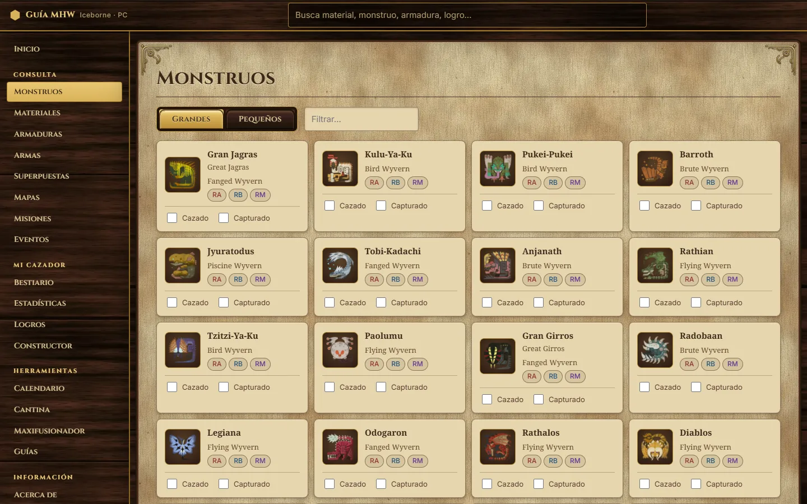
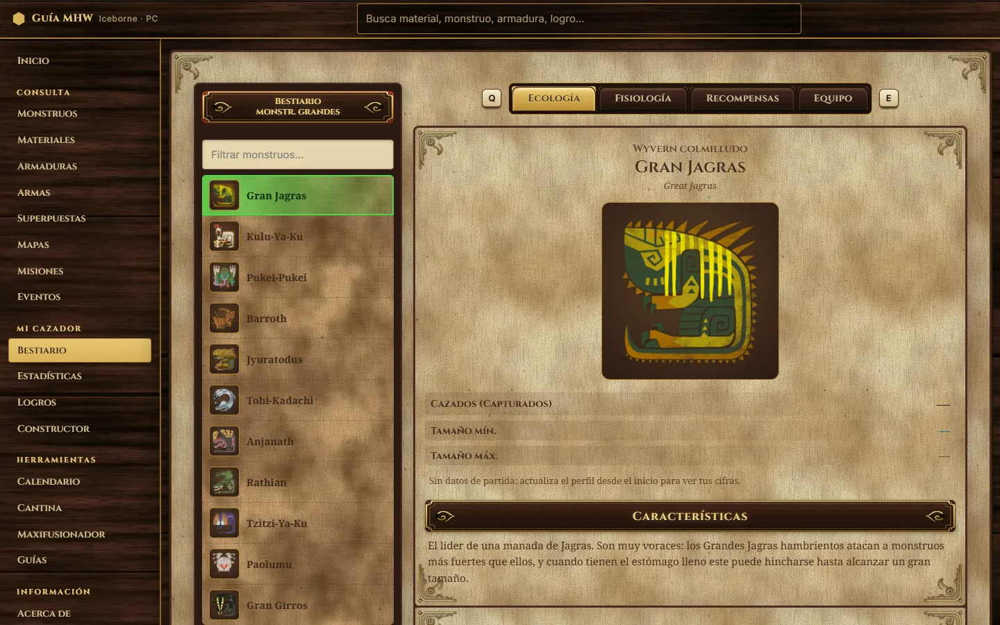
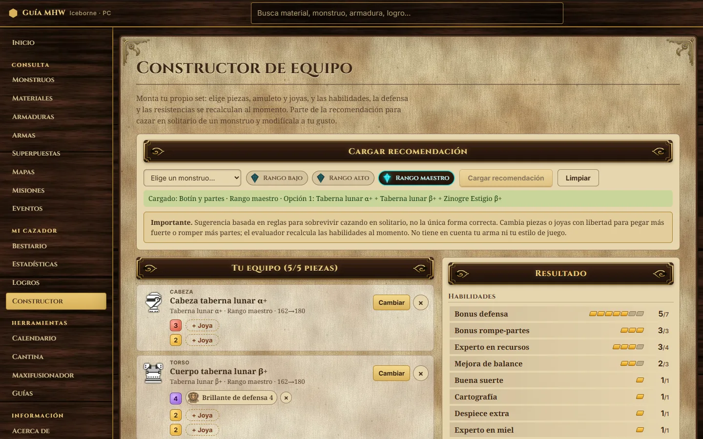

# Guía MHW Iceborne · PC

Guía de escritorio, gratuita y no oficial, en español para *Monster Hunter: World + Iceborne* (PC): busca cualquier material, monstruo, armadura o logro y descubre dónde y cómo conseguirlo, todo sin conexión y en tu propio equipo.

[](https://github.com/Realvanargoz/guia-mhw-iceborne-pc/actions/workflows/ci.yml)
[](LICENSE)

## Descargar

Ve a la página de **[Releases](../../releases)** y elige una de las dos opciones:

- **Instalador** (`GuiaMHW-x.y.z-setup.exe`): se instala por usuario, sin permisos de administrador. Tus datos quedan en `%LOCALAPPDATA%\GuiaMHW`.
- **Zip portable** (`GuiaMHW-x.y.z-portable.zip`): descomprímelo donde quieras y ejecuta `GuiaMHW.exe`. Tus datos quedan en la carpeta `GuiaMHW\data` junto al ejecutable.

**Verifica la descarga.** Cada release incluye `SHA256SUMS.txt`. Calcula el hash y compáralo:

```powershell
Get-FileHash .\GuiaMHW-x.y.z-setup.exe -Algorithm SHA256
```

**Aviso de SmartScreen.** Los ejecutables no están firmados con un certificado de pago, así que Windows SmartScreen puede mostrar «Windows protegió su PC». Si has comprobado el hash, pulsa «Más información» y luego «Ejecutar de todas formas».

Requisitos: Windows 10 u 11 y Microsoft Edge (la aplicación abre su propia ventana con Edge en modo aplicación).

## Características

- **Búsqueda bilingüe** (español e inglés), sin distinguir acentos, sobre todo el catálogo.
- **Bestiario** con debilidades, partes, recompensas y hábitats.
- **Constructor de equipo** con composiciones guardadas en tu base de datos local.
- **Calendario** de festivales, asedios y recordatorios propios.
- **Cantina**, **fusionador** de objetos y guías de misiones, mapas y coronas.
- **Logros** con seguimiento de progreso.
- **Perfil desde tu partida de Steam**: se lee en modo solo lectura y solo al pulsar «Actualizar perfil».
- **Funciona sin conexión**, sin cuenta, sin publicidad y sin telemetría.
- Interfaz con **índice lateral**, adaptable a **cualquier tamaño de ventana**, con **alto contraste** y uso completo con **teclado**.

## Capturas







## Privacidad y seguridad

- No hay cuentas, telemetría ni publicidad. Tus datos se guardan solo en tu equipo.
- El servidor local escucha únicamente en `127.0.0.1`, protege cada sesión con un token aleatorio y valida las entradas.
- La partida de Steam y la carpeta del juego se leen siempre en modo solo lectura. No se piden permisos de administrador ni se instalan servicios, tareas programadas ni arranque automático.
- Ha pasado revisiones internas de seguridad (revisión de código, pruebas con entradas maliciosas, comprobación de dependencias y de la huella en el sistema). **Son revisiones propias: no constituyen una certificación ni una auditoría externa.**

Detalles en [SECURITY.md](SECURITY.md) (cómo informar de una vulnerabilidad) y en [Docs/SEGURIDAD-MODELO.md](Docs/SEGURIDAD-MODELO.md) (modelo de amenazas). La arquitectura está en [Docs/ARQUITECTURA.md](Docs/ARQUITECTURA.md).

## Compilar desde el código

Requisitos: Windows 10/11, Python 3.14, Node 22 y, opcionalmente, Inno Setup 6 (para el instalador).

**Arrancar en modo desarrollo** (crea `.venv`, compila la web, genera el catálogo y abre el servidor en `http://127.0.0.1:8765`):

```powershell
pwsh scripts/dev.ps1
```

**Catálogo.** Se genera con el ETL, que descarga MHWorldData en un commit fijado y datos de mhw-db.com, y los combina con las semillas de `research/`:

```powershell
cd etl
python -m mhw_etl all --out ../build/catalog.db
```

**Iconos del juego.** No están en el repositorio (son contenido de Capcom). Si quieres verlos en tu copia local, extráelos de **tu propia copia del juego**:

1. `pwsh scripts/extract-ui.ps1` (usa WorldChunkTool y la biblioteca Oodle, que **no se distribuyen**: debes obtenerlos tú; mira `tools/worldchunktool`). Solo lee los `chunk*.bin`.
2. `python -m mhw_etl.icons all` (desde la raíz, con `PYTHONPATH=etl`) convierte y asocia los iconos en `data/icons/`.

**Pruebas:**

```powershell
pip install -r api/requirements.txt -r api/requirements-dev.txt -r etl/requirements.txt
pytest tests
```

**Empaquetar** (zip portable, instalador y sumas de verificación en `dist/`):

```powershell
pwsh scripts/build-windows.ps1 -Version x.y.z -OptimizeIcons
```

**Nuevas versiones:** añade una sección `## x.y.z` a `CHANGELOG.txt`; el instalador la muestra como «Novedades».

## Estructura

| Carpeta | Contenido |
|---|---|
| `api/` | API FastAPI sobre SQLite: búsqueda en memoria, fichas, progreso, constructor, lanzador de escritorio y lector de partidas en Python (`app/savereader/`). |
| `web/` | Interfaz React + Vite en español con índice lateral. |
| `etl/` | Construye `build/catalog.db` a partir de MHWorldData, mhw-db.com y las semillas de investigación. |
| `research/` | Semillas JSON de la investigación (una carpeta por tema); cada dato lleva `sources[]` con sus fuentes. |
| `tests/` | Pruebas de pytest (base de datos, búsqueda, lector de partidas con fuzzing, lanzador, paquete). |
| `scripts/` | `dev.ps1`, `build-windows.ps1`, `extract-ui.ps1` y utilidades. |
| `installer/` | Script de Inno Setup del instalador. |
| `tools/savereader/` | Referencia en C# usada para generar las tablas del lector de partidas en Python (ver `THIRD_PARTY/`). |
| `tools/worldchunktool/` | Dockerfile y parche que compilan WorldChunkTool desde su código fuente. |
| `tools/e2e/` | Prueba de humo de navegación. |
| `design/` | Fuente del arte de la interfaz (SVG/HTML/GSAP renderizado con HyperFrames). |
| `Docs/` | Documentación: arquitectura, modelo de seguridad y [constructor por fases](Docs/constructor-por-fases.md) y [firma y antivirus](Docs/firma-y-antivirus.md). |

## Créditos y avisos legales

- El **código y los textos originales** se publican bajo la licencia **MIT** ([LICENSE](LICENSE)). La licencia no cubre material de terceros.
- Las licencias de las librerías, tipografías y código de terceros están en [THIRD_PARTY_NOTICES.txt](THIRD_PARTY_NOTICES.txt).
- Monster Hunter, Monster Hunter: World, Iceborne, sus personajes, monstruos, nombres, iconos e imágenes son marcas y obras protegidas de **CAPCOM CO., LTD.** © CAPCOM CO., LTD. ALL RIGHTS RESERVED. Steam es una marca de Valve Corporation. Este proyecto es una guía de aficionados: **no está afiliado, patrocinado ni respaldado por Capcom, Valve ni Steam**. Si eres titular de derechos y quieres que se retire o cambie algún contenido, escribe a info@asesoriatics.com.
- **Idea del constructor de builds:** el constructor por fases se basa en el método de **Dem** ([youtube.com/@Demsito](https://www.youtube.com/@Demsito)), explicado en su vídeo [«DEJA de COPIAR Builds y EMPIEZA a CREARLAS con ESTE Método»](https://www.youtube.com/watch?v=ozzSBPNg5aw). La idea y el orden de los pasos son suyos; esta guía no está afiliada a su canal.
- **Fuentes de datos:** MHWorldData (Gathering Hall Studios, MIT), mhw-db.com, Kiranico, Fextralife Monster Hunter World Wiki, Monster Hunter Wiki, PowerPyx, mhw.poedb.tw (también los iconos de los ingredientes de la cantina), Fandom («How the Monster Hunter World Canteen Works»: regla de nivel por rama), Team BRG y la guía «Meowster's Hunting Book» de Steam Community (colores de las ramas de la cantina), Game8, Pondryhills, el calendario oficial de eventos de Capcom y los textos oficiales de logros de Steam. Los vídeos de YouTube pertenecen a sus autores y solo se cargan al pulsarlos. Las guías son resúmenes propios y cada ficha enlaza sus fuentes.

## Desarrollo con IA

Esta aplicación se ha desarrollado con la ayuda de **inteligencia artificial** (Claude, de Anthropic) bajo supervisión humana: programación, pruebas, revisión de seguridad y organización de la investigación. El código se probó y se revisó, pero la IA puede cometer errores: contrasta los datos importantes con el juego.

El software se ofrece «tal cual», sin garantía de ningún tipo. Úsalo bajo tu responsabilidad.

## Contacto

Dudas, errores, sugerencias o solicitudes legales: info@asesoriatics.com. Para contribuir, lee [CONTRIBUTING.md](CONTRIBUTING.md).

## English summary

Unofficial, free, Spanish-language desktop guide for Monster Hunter: World + Iceborne on PC. It runs fully offline on your machine: a local FastAPI server bound to 127.0.0.1 (with a per-launch session token) serves a React UI inside an Edge app window, backed by SQLite. It offers bilingual search, a bestiary, a build planner, an event calendar, and a profile read (read-only) from your own Steam save. Download the installer or the portable zip from Releases and verify it with SHA256SUMS.txt. Code and original texts are MIT-licensed; game assets and icons are NOT included (they belong to Capcom, and you can extract icons from your own copy). Not affiliated with Capcom, Valve or Steam. Built with AI assistance under human supervision; the security reviews were internal, not an external audit. Build from source with `pwsh scripts/dev.ps1`; see CONTRIBUTING.md.
